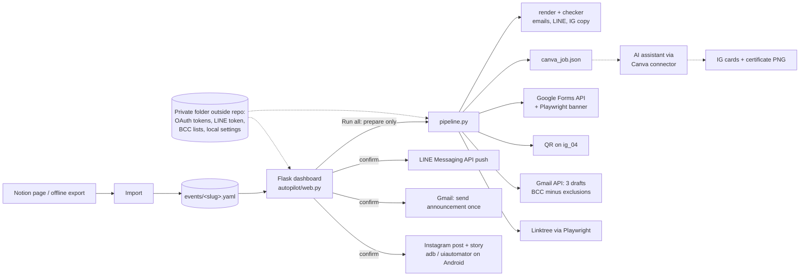

# Club Autopilot

**A few clicks on one dashboard run a student club's whole weekly lecture workflow: sign-up form, Canva cards, QR code, emails, LINE, Linktree and Instagram. Every public action waits for a human to confirm it.**

Built solo for **STEMergent Hacks 2026** (Hackathon pathway, working prototype) for **陽明交大創創社 / NYCU Innovation & Entrepreneurship Club (NYCU IEC)**. It was demoed live on the club's real lecture of 2026-11-25 (Session 6, speaker 謝慈 Candice).

▶ **Demo video (2:16):** https://youtu.be/mQXyeGE0Whc

---

## The problem

Every week, a club officer prepares one lecture by hand. That means a Google Form, an announcement email to members, a reminder and a follow-up, LINE messages to two groups, four Instagram cards plus a post and a story, a QR code, a Linktree update and a speaker certificate. That is about ten tools.

The real cost is **attention, not time**. Switching between tasks all week leaves officers with no energy to polish the details, and no headspace to think about where the club should go next.

## What it does

From one Flask dashboard (`http://127.0.0.1:5050`, Chinese/English toggle):

| Step | What happens | Where |
|---|---|---|
| 1. Import | Load the next lecture (speaker, time, room, hook) from the club's Notion page, or from an offline export | `notion_import.py` |
| 2. Copy + rule check | Generate the announcement, reminder and follow-up emails, LINE and IG copy; check them against the club's style rules | `render.py`, `checker.py` |
| 3. Canva | Prepare a job file. Club templates are **copied** (never edited), filled with the speaker, title and photo, and exported as 4 IG cards and a certificate | `canva_job.py`, `scripts/canva_ops.py` |
| 4. Google Forms | Create the pre-lecture sign-up form and the post-lecture feedback form (reused if they already exist) | `forms_api.py` |
| 5. Form banner | Add the club header banner and confirmation message (the Forms API cannot do this, so headless Playwright does it) | `form_banner.py` |
| 6. QR | Stamp a QR code for the live sign-up form onto IG card 4 | `canva_step.py` |
| 7. Certificate | Speaker thank-you certificate (PNG/PDF) | `certificate.py` |
| 8. Gmail drafts | Create three drafts in the club inbox. The BCC list comes from the members list or form responses, minus a private exclusion list | `gmail_api.py`, `drafts_sync.py`, `bcc_exclude.py` |
| 9. Linktree | Add this week's form link and hide older form links (hidden, not deleted) | `linktree.py` |
| 10. Counts | Registration and feedback counts (numbers only) | `responses.py` |

**Run all** does steps 1–10 in the background. It creates and prepares things; it never emails, posts or sends anything.

**Publish (needs you)**, where each button has its own confirm dialog:

- **Send to LINE**: pushes the shown text to the club's LINE groups through the Messaging API.
- **Send announcement email**: sends the existing announcement draft once, by BCC. A second send is refused, and the Gmail message ID is recorded.
- **Save IG draft (phone)**: saves an IG draft by default. With *publish* ticked and a second confirm, it drives the club's Android phone over adb/uiautomator. It uploads the 4 cards, adds the configured song, pastes the caption and publishes.
- **Reshare post to Story (phone)**: saves a story draft by default. With *publish* ticked and confirmed, it opens the newest post and checks that it matches this week's cover card. It then likes and reposts it, reshares it to a story with a sign-up link sticker and music, and publishes.

## Architecture



Each run writes to a new timestamped folder `out/<event>/runs/<timestamp>-<mode>/`. Old outputs are never deleted.

## Setup and run

Python 3 (developed on 3.13). The phone steps also need Android `adb`; `scrcpy` is optional, for watching.

```bash
python -m venv .venv
. .venv/bin/activate            # Windows: .venv\Scripts\activate   (or just run run_web.cmd)
pip install -r requirements.txt
python -m playwright install chromium

python -m autopilot web --port 5050          # dashboard at http://127.0.0.1:5050
python -m autopilot run tests/fixtures/2026-11-25-candice.yaml   # preview only, no Google/LINE/IG
pytest -q
```

Private settings live **outside the repo**, in `%USERPROFILE%\創創社-私密\` (or wherever environment variables point):

| What | Where |
|---|---|
| Personal Google account that owns the Forms | env `AUTOPILOT_FORMS_ACCOUNT`, or `forms_account:` in `autopilot_local.yaml` |
| Notion page id / token | env `NOTION_PAGE_ID`, `NOTION_TOKEN`, or `autopilot_local.yaml` |
| Google OAuth tokens | `創創社-私密\google-oauth\` (the code refuses an OAuth folder inside the repo) |
| LINE channel token and group IDs | env `LINE_CHANNEL_ACCESS_TOKEN`, `LINE_GROUP_IDS`, or `創創社-私密\line\line_bot.json` |
| BCC exclusion list | env `CLUB_BCC_EXCLUDE_FILE`, or `創創社-私密\密件副本\bcc_exclude.txt` |

See `autopilot/local_settings.py` for the format. Without these settings, the preview, the copy and the tests all still work.

## Safety design

- **Run all never publishes.** Its confirm dialog says so: nothing is emailed, posted or sent from that button.
- **Every public action is a separate button with its own confirm dialog** (LINE, email). Instagram publishing also needs a *publish* box ticked plus a second confirm; otherwise it only saves a draft.
- **LINE is only ever sent from its button**, never as part of a pipeline run.
- **Email:** the announcement is sent once, from an existing draft; a duplicate send is refused. The reminder and follow-up stay as drafts.
- **BCC privacy:** recipients are always BCC. A private exclusion list (full address or local-part match, case-insensitive) is applied to every BCC, and the UI and logs show only counts.
- **Instagram guard:** before every tap, the phone flow reads the screen and stops if the tap would land on Share/Post/Remove at the wrong moment. It also stops if the phone is locked. The story flow checks that the post it opened matches this week's cover before liking or resharing.
- **Canva templates are never edited.** New copies are made for each lecture.
- **Accounts:** the forms step refuses any account other than the configured personal one, and never uses the club account for forms.
- **No secrets in the repo:** tokens, member lists, exclusion lists and local settings are git-ignored and live outside the repo.

## Tests

```bash
pytest -q        # 122 tests
```

Google, Gmail, LINE, Linktree and adb are all mocked. The tests cover the pipeline, the rule checker, the form banner, the QR stamp, BCC exclusion, the dashboard routes (including confirm and send-once), the i18n of every UI string, IG music and story logic, and run-all ordering.

## Honest disclosures

**Pre-existing work.** This project builds on my own pre-existing personal scripts for club work, written before the hackathon. They were one-off Python scripts with hard-coded lecture numbers, form IDs and paths: a Google OAuth helper, a Forms API script for one sign-up form, a feedback-form script, a Gmail-draft script, HTML letter templates, and an experimental Playwright script for Canva. Those scripts are **not** in this repo; their logic was rewritten here.

**New during the hackathon:**

- An event-file-driven pipeline with no hard-coded lecture data.
- The Flask dashboard with Notion import, Run all, per-step status and Chinese/English UI.
- The orchestration and the separate, confirmed Publish actions.
- Rebuilt email templates and a rule checker for the club's style guide.
- The Canva job flow (copy template → fill → export).
- Automatic Google Form banner and confirmation message.
- The page-4 QR stamp, including the tilted-frame fix.
- The certificate renderer.
- Gmail drafts with in-place updates, plus the private BCC exclusion list.
- LINE push to the club groups.
- Linktree sync.
- Instagram carousel publishing with music, and the story reshare with a link sticker, both via adb.
- The test suite.

**Canva step.** Canva has no public API for copying a template and editing its text, so the dashboard writes a job file. An **AI assistant then performs the Canva step through Canva's official connector**: it copies the templates into new designs, fills them, and exports PNG/PDF. The dashboard process holds no Canva credentials.

**AI assistance.** AI coding assistants were used heavily to write, refactor and test the code, and to drive the Notion/Canva connectors under my direction. Lecture content comes from the club's own Notion page.

**Third-party services and tools:**

- Google Forms API and Gmail API (OAuth)
- LINE Messaging API
- Linktree (web UI via Playwright)
- Instagram (Android app via adb/uiautomator)
- Canva (via its connector)
- Notion API
- Playwright
- scrcpy (screen mirroring for the recording)
- edge-tts (demo video narration)
- Python, Flask, Jinja2, PyYAML, Pillow, qrcode, OpenCV

## Limitations

- **Instagram automation is tied to one phone.** Screen positions were measured on one Android phone (1080×2400) with the Chinese UI, so an IG app update or a different phone may need re-measuring (`config/ig_adb.yaml`). Instagram has no public API for music or link stickers on personal and creator posts, which is why it uses adb.
- **Canva needs an AI assistant with the Canva connector** to run the job file. Without one, the officer does that step by hand.
- **Linktree and the Google Forms banner use browser automation**, so a UI change on either site can break them. Linktree needs a one-time human login.
- **Windows first.** It was built and run on Windows 11 (the `.cmd` helpers); the core and the tests also run on Linux.
- **Built around one club.** Templates and rules follow NYCU IEC's style guide, so another club would need its own templates and rules.

## License

MIT, see `LICENSE`.
